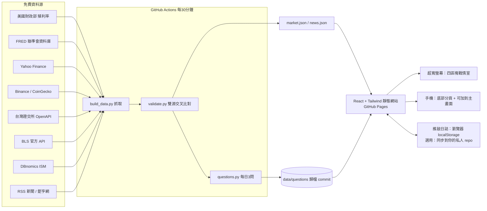

# Macro & Market Watch — 宏觀經濟與跨資產推敲儀表板

超寬螢幕戰情室 + 手機可用的總經儀表板。**零成本**：GitHub Actions 定時抓免費資料 → 交叉比對 → GitHub Pages 發布。



## 一、部署到 GitHub（約 10 分鐘，全程免費）

1. **建立 repo**：GitHub 右上 `+` → New repository → 名稱例如 `macro-watch` → 選 **Public**（免費帳號的 Pages 需要公開 repo）→ Create。
2. **上傳程式碼**：解壓縮 `macro-dashboard.zip`，在新 repo 頁面點 *uploading an existing file*，把資料夾**裡面的所有檔案與資料夾**（包含 `.github`）拖進去 → Commit。
   > 若拖曳後看不到 `.github` 資料夾（macOS 會隱藏點開頭的檔案），在 Finder 按 `⌘ + Shift + .` 顯示隱藏檔再拖一次。也可用 `git push`。
3. **開啟 Pages**：repo → Settings → Pages → *Build and deployment* → Source 選 **GitHub Actions**。
4. **開啟 Actions 寫入權限**：Settings → Actions → General → *Workflow permissions* 選 **Read and write permissions** → Save。
5. **第一次執行**：Actions 分頁 → 左側「更新資料並部署」→ *Run workflow*（`force_questions` 填 `1` 可立即產生第一組 3 問）。約 3–5 分鐘後完成。
6. **網址**：`https://<你的帳號>.github.io/macro-watch/`。手機用 Safari/Chrome 開啟 → 分享 → **加入主畫面**，就像 App 一樣全螢幕使用。

之後每 30 分鐘（平日）/ 3 小時（週末）自動更新，不需任何操作。

## 二、資料來源與交叉比對（務必正確的設計）

每次更新，每個指標都會拿**兩個獨立來源在同一日期**比對，結果顯示在每個數字旁（✓ 雙源一致 / ⚠ 來源差異 / ○ 單一來源），完整明細在「資料驗證」頁。

| 指標 | 主來源 | 比對來源 | 容忍度 | 說明 |
|---|---|---|---|---|
| US10Y / US02Y | 美國財政部官方殖利率曲線 | FRED DGS10/DGS2；Yahoo ^TNX | 1bp；6bp | ^TNX 取樣時間不同 |
| 10Y-2Y 利差 | 財政部 10Y−2Y 計算 | FRED T10Y2Y | 1bp | |
| 高收益債利差 | FRED BAMLH0A0HYM2 | — | — | 單一來源；FRED 自 2026/4 起僅保留近 3 年 |
| WTI | Yahoo CL=F | FRED DCOILWTICO | 2.5% | 期貨 vs 現貨 |
| 黃金 | Yahoo GC=F | CoinGecko PAXG | 2.5% | PAXG 為實體黃金代幣 |
| 銅 | Yahoo HG=F | FRED/IMF 全球銅價（月） | 15% | 量級檢查，COMEX/LME 有關稅價差 |
| DXY | Yahoo DX-Y.NYB | ① ICE 公式自六國匯率計算 ② 聯準會匯率計算 | 0.3%；0.6% | 公式：50.14348112×EURUSD^-0.576×USDJPY^0.136×GBPUSD^-0.119×USDCAD^0.091×USDSEK^0.042×USDCHF^0.036 |
| USD/JPY、USD/TWD | Yahoo | FRED 聯準會 H.10 匯率 | 0.8% | 紐約中午報價 |
| 台股加權 | Yahoo ^TWII | 證交所官方 FMTQIK | 0.1% | |
| S&P 500 | Yahoo ^GSPC | FRED SP500 | 0.1% | |
| VIX | Yahoo ^VIX | FRED VIXCLS（Cboe） | 1% | 盤中 5 分鐘線來自 Yahoo |
| BTC/USDT | Binance | CoinGecko；Yahoo BTC-USD | 0.8% | 網頁另每 30 秒直連 Binance 取即時價 |
| SOX | Yahoo ^SOX | — | — | 無免費第二來源，標示單一來源 |
| CPI / 核心 CPI、非農、失業率 | FRED | BLS 官方 API | 完全一致 | |
| ISM 製造業 PMI | DBnomics 鏡像 | — | — | ISM 不授權 FRED，單一來源 |

其他保護：抓取失敗會改用備援來源並標示「↺ 備援來源」；全部失敗則沿用上一版資料並標示「⏸ 沿用舊資料」，**不會默默顯示錯誤數字**。缺月資料（例如 2025/10 美國政府停擺未發布的 CPI）會留空，不會插值。

## 三、功能對照

- **左**：US10Y、US02Y、10Y-2Y、HY 利差（附 Sparkline）；銅、WTI、黃金、DXY、USD/JPY；未來經濟事件（BLS 日曆、ISM、FOMC）。
- **中**：S&P 類股 / 費半成分股 / 台股權值股熱圖；TAIEX、USD/TWD、BTC；**BTC vs 反向 DXY 疊加圖**；VIX 盤中曲線。
- **右**：新聞（標籤：FED、通膨、就業、地緣政治、半導體、能源、匯率、債市、加密、台股、中國）＋ 今日 3 問。
- **下**：CPI/核心 CPI、非農、失業率、ISM PMI 長期趨勢。
- **推敲矩陣**（門檻在 `shared/config.json` 可改）：流動性緊縮（DXY↑ 且 US02Y↑）、套息反轉（USD/JPY 急跌）、科技估值壓力（US10Y 急升）→ 對應區塊閃爍高亮。
- **每日 3 問**：每個美股交易日收盤後（約台北 05:30–06:30）產生；依 z-score 找最大異動、相關性背離、事件日/新聞主題。提交後給鼓勵與重點提示。
- **推敲日誌**：日曆 / 清單 / 只看事件日、全文搜尋、補寫與編輯、匯出匯入 JSON。

> 關於 BTC vs DXY：為避免雙 Y 軸造成的視覺誤導，兩者在視窗起點都指數化為 100，DXY 取倒數（等同反向座標）。兩線同向 = 經典反向關係成立；分岔 = 關係失效。圖上同時顯示日報酬相關係數 ρ。

## 四、選用設定（仍然免費）

- **跨裝置同步日誌**：另建一個 **Private** repo（如 `macro-journal`）→ GitHub Settings → Developer settings → Fine-grained tokens → 只授權該 repo 的 *Contents: Read and write* → 在網站「推敲日誌 → 備份與跨裝置同步」填入。手機、電腦各填一次即可。Token 只存在該裝置瀏覽器。
- **用 LLM 生成提問**：到 Google AI Studio 申請免費 API key → repo Settings → Secrets and variables → Actions → 新增 `GEMINI_API_KEY`。LLM 只會改寫問題文字，數字一律來自已驗證資料；失敗自動退回規則式。

## 五、限制（誠實說明）

- 不是逐筆即時行情：靜態網站 + 30 分鐘排程（GitHub 排程常延遲 5–15 分鐘）；Yahoo 指數本身約延遲 15 分鐘。BTC 在網頁上每 30 秒更新。
- Yahoo Finance 為非官方介面，若被擋會在「資料驗證」頁顯示錯誤並改用備援。
- 公開 repo 代表儀表板網址是公開的（只有市場資料）；**你的回答不會出現在公開 repo**。
- 公開 repo 若 60 天沒有任何 commit，GitHub 會暫停排程；本系統每天自動 commit 提問歸檔，正常情況不會發生。

## 六、本機開發

```bash
pip install -r scripts/requirements.txt
python scripts/test_pipeline.py           # 離線測試
python scripts/build_data.py              # 抓真實資料到 public/data
npm install && npm run dev
```

資料庫 Schema（若日後改用後端）：`docs/schema.sql`。
